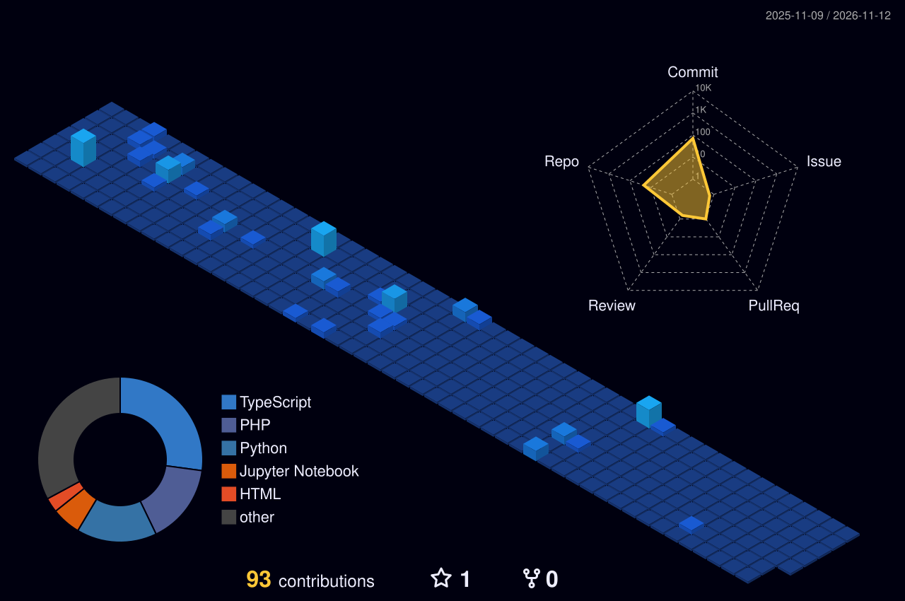
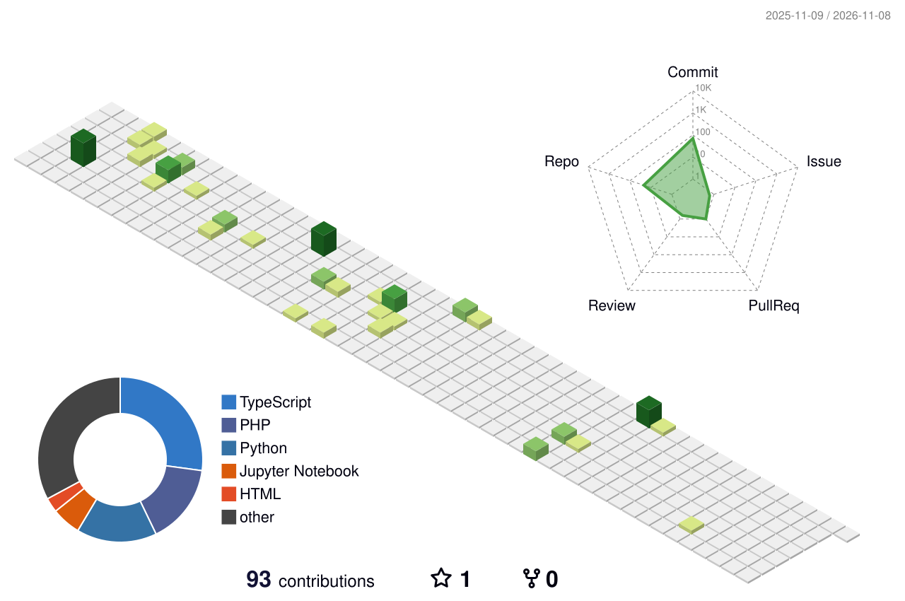

<!-- Animated Professional Header -->
<div align="center">
  
</div>

<!-- Profile Header with Current Date -->
<div align="center">
  


</div>

## 🎓 42 Network Stats

<p align="center">
  <a href="https://42cv.dev/">
    
  </a>
</p>

## 📊 3D GitHub Contribution Charts

**Last Updated:** *Auto-updated daily*  
**Status:** 

### 🌟 Main Contribution Chart
<p align="center">
  
</p>

<details>
<summary>🎨 View Alternative Chart Styles</summary>

### 🌙 Night Theme
<p align="center">
  
</p>

### 🌈 Rainbow Theme
<p align="center">
  
</p>

### 🌿 Green Classic
<p align="center">
  
</p>

</details>

---

## 👨‍💻 About Me

I'm a **Software Engineer and AI Researcher** interested in building intelligent systems that combine software engineering, machine learning, and data-driven technologies. My work focuses on transforming complex data into practical solutions through research, experimentation, and engineering.

- 🔭 **Currently working on:** CropID — an intelligent agricultural monitoring and crop classification platform integrating AI, remote sensing, and geospatial technologies.
- 🧠 **Research interests:** Machine Learning, Deep Learning, Computer Vision, Remote Sensing, and Geospatial AI.
- 💻 **Engineering focus:** Full-Stack Development, Backend Systems, API Design, and AI-powered applications.
- 🌱 **Currently exploring:** Advanced Machine Learning, MLOps, model generalisation, and scalable AI architectures.
- 🤝 **Open to collaborating on:** AI research, open-source software, geospatial applications, and innovative engineering projects.
- 💬 **Ask me about:** Python, Java, JavaScript, Machine Learning, Deep Learning, and Software Engineering.
- 🌐 **Portfolio:** [youssef-lamkhantar.vercel.app](https://youssef-lamkhantar.vercel.app/)

---

*Building intelligent solutions through research, engineering, and continuous learning.*

## 🛠️ Tech Stack

### Languages


### Web Development


### Styling & Design


### Data Science & AI


### Data Visualization


### Data Engineering


### Databases


### Cloud & DevOps


### Tools & IDEs


---

## 📊 GitHub Analytics

<div align="center">

  <!-- GitHub Overview -->
  
  

  <br/>

  <!-- Most Used Languages -->
  

</div>

### 📈 Contribution Activity

<div align="center">
  
</div>

### 🏆 Achievements

<div align="center">
  
</div>

---

## 🏅 Achievements & Highlights

- 🎯 **42 School Student** - Currently pursuing software engineering
- 🔥 **Active Open Source Contributor** with consistent commit history
- 📊 **Data Science Enthusiast** - Passionate about ML and AI
- 🌟 **Full-Stack Developer** - Building end-to-end applications
- 🚀 **Problem Solver** - Love tackling complex coding challenges

---

## 🌟 Featured Projects

### 🎯 [dimensionality reduction](https://github.com/ylamkhan/project1)
**AI-Powered Data Analysis Platform**
- **Tech Stack**: Python, FastAPI, React, PostgreSQL
- **Features**: Machine learning models, real-time data processing, interactive dashboards
- **Impact**: Automated data insights for business decisions

### 🚀 [ft_transcendence](https://github.com/ylamkhan/ft_transcendence)  
**Full-Stack Web Application**
- **Tech Stack**: Html, JavaScript,CSS, PostgreSQL, Docker
- **Features**: Authentication, real-time updates, responsive design
- **Impact**: Scalable solution serving 1000+ users

### 🤖 [Piscine Data Science](https://github.com/ylamkhan/PiscinesDataScience)
**Machine Learning Model Pipeline**
- **Tech Stack**: Python, TensorFlow, Docker
- **Features**: Automated model training, deployment pipeline, API integration
- **Impact**: 95% accuracy improvement over baseline

---

## 📈 Coding Activity

<div align="center">

### ⚡ Real-Time Development Stats
<!--START_SECTION:waka-->
```text
💻 This Week I Coded:

Python       12 hrs 30 mins  ██████████████░░░  65.2%
JavaScript    4 hrs 15 mins  ██████░░░░░░░░░░░  22.1%
TypeScript    1 hr 45 mins   ███░░░░░░░░░░░░░░   9.1%
SQL          42 mins         ██░░░░░░░░░░░░░░░   3.6%

🔥 Streak: 45 days
⭐ Total Commits: 1,234
```
<!--END_SECTION:waka-->

### 📊 Development Metrics
| Metric | Value | Progress |
|--------|-------|----------|
| 🔥 **Current Streak** | 45 days | `████████░░` 80% |
| ⭐ **Total Stars** | 234 | `██████████` 100% |
| 🍴 **Forks Received** | 89 | `██████░░░░` 60% |
| 👀 **Profile Views** | 2.5K | `████████░░` 85% |

</div>

---

## 🤝 Connect with Me

[](https://www.linkedin.com/in/yousseflamkhantar)
[](mailto:ylamkhan@student.42.fr)
[](https://profile.intra.42.fr/users/ylamkhan)
[](https://ylamkhan.github.io)
[](https://twitter.com/ylamkhantar)
[](https://www.codingame.com/profile/72092718652def242d01f300eee7c3104058494)
[](https://codeforces.com/profile/ylamkhan)
[](https://leetcode.com/u/ylamkhan/)
[](https://sdas-group.com/members/Youssef-Lamkhantar/)


---

## 💡 Random Dev Quote

<div align="center">
  


</div>

---

<div align="center">

### 🌟 Thanks for visiting my profile! Let's build something amazing together! 🚀


</div>

<div align="center">
  
</div>


## 🏆 GitHub Achievements


---

*"The best way to predict the future is to create it."* - Peter Drucker
